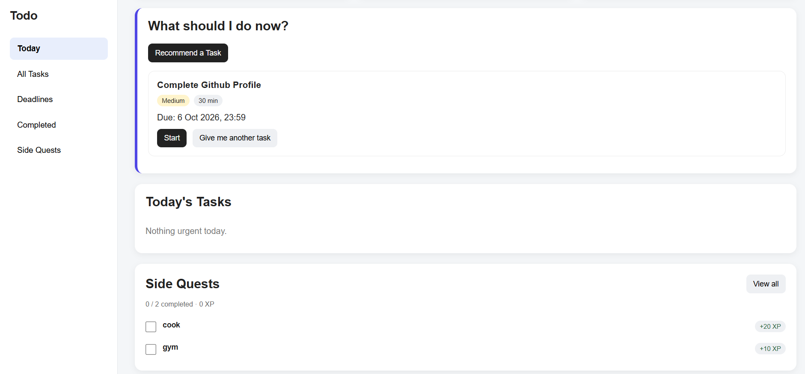

# Focus: Todo and Side Quests

Focus is a personal productivity application for planning one-off work and building recurring habits in the same place. It combines structured Todo tasks with recurring, XP-based Side Quests, so users can manage deadlines without losing sight of smaller daily routines.

Unlike a basic to-do list, Focus can recommend what to work on next. Its rule-based scoring considers deadline urgency, priority, whether a task was selected for today, whether it is already in progress, and how quickly it can be completed. The recommendation remains explainable and deterministic rather than depending on an external AI service.

## Highlights

- FastAPI JSON API backed by SQLite
- Responsive HTML, CSS, and vanilla JavaScript frontend
- Strict Todo validation for priorities, statuses, time estimates, and ISO deadlines
- Explainable task recommendations based on urgency, priority, current status, and effort
- Hong Kong timezone handling for daily progress and weekly statistics
- Daily and selected-weekday Side Quest schedules
- One completion per Side Quest per Hong Kong calendar day
- Historical XP snapshots that are preserved when a quest is edited or deactivated
- Frontend diagnostics that retain FastAPI validation details in the browser console
- Regression tests for Todo validation, timezone boundaries, recurrence, completion history, and XP rules

## Technology

- Python 3.12
- FastAPI and Pydantic
- SQLite
- HTML, CSS, and vanilla JavaScript
- `unittest`

## Project structure

```text
.
├── main.py                    # Todo API and application entry point
├── sidequests.py              # Side Quest routes, storage, and statistics
├── frontend/                  # Browser UI and styles
├── tests/                     # Backend regression tests
├── screenshots/               # Public demo images (no production data)
├── auth-setup/                # Optional server authentication installer
├── SIDE_QUESTS.md             # Side Quest API and behavior notes
├── requirements.txt           # Python runtime dependencies
└── .env.example               # Optional configuration reference
```

## Run the backend locally

```bash
python -m venv venv
source venv/bin/activate
pip install -r requirements.txt
uvicorn main:app --reload
```

On Windows PowerShell, activate the environment with:

```powershell
.\venv\Scripts\Activate.ps1
```

The API is available at `http://127.0.0.1:8000`, with interactive documentation at `http://127.0.0.1:8000/docs`.

The application stores data in `tasks.db` beside `main.py` by default. To use a different location, set `TODO_DB_PATH` before starting Uvicorn:

```bash
export TODO_DB_PATH=/path/to/local/tasks.db
```

`.env.example` documents supported values, but the application does not automatically load `.env` files. Export variables through your shell, process manager, or deployment platform.

## Run the tests

```bash
python -m unittest discover -s tests -v
```

## Frontend setup

The frontend expects to be served from the same origin as the API and calls endpoints below `/api/`. A development or production web server must:

1. Serve the files in `frontend/`.
2. Proxy `/api/` to the FastAPI server.
3. Remove the `/api` prefix when forwarding requests.

Do not publish a real database, `.env` file, authentication file, server log, or credential with the repository.

## Current status

Todo validation and Side Quests are implemented and covered by backend regression tests. The refreshed responsive interface and expanded frontend error reporting are currently under development on `feature/ui-refresh`.

The optional authentication installer is deployment-specific and should be reviewed and adapted before use on another server.

## Screenshot


